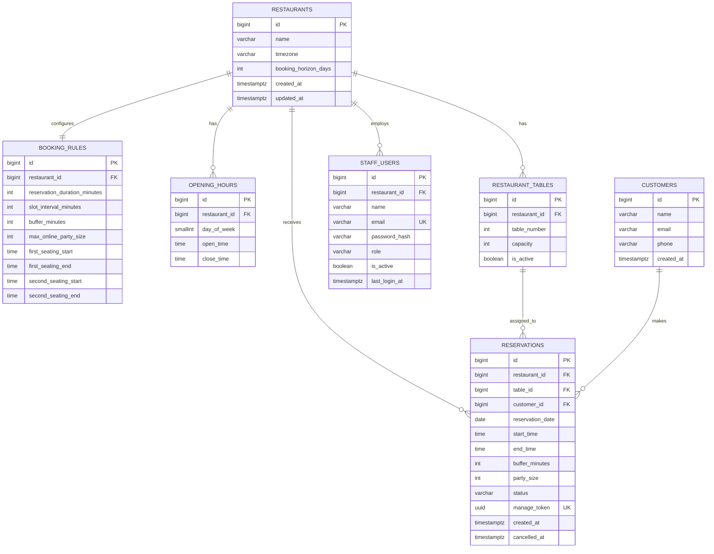

# Database Diagram — Restaurant Booking System

Relational schema for the MVP described in `PRD.md` (§9 datamodel, §7 forretningsregler, §14 beslutninger).
Target stack: **PostgreSQL (Neon)** + **SQLModel/SQLAlchemy** + **Alembic** migrations, connection via `DATABASE_URL`.

Files in this directory:

| File | Indhold |
|---|---|
| `database-diagram.md` | Dette dokument (diagram + designnoter) |
| `database-diagram.mmd` | Raw Mermaid ER-kilde |
| `database-diagram.svg` / `.png` | Rendered diagram (SVG/PNG) |

## ER-diagram



Rendered version: 

## Entiteter (fra PRD §9)

| PRD-entitet | Tabel | Bemærkning |
|---|---|---|
| Restaurant | `restaurants` | Navn, tidszone (`Europe/Copenhagen`), bookinghorisont (30 dage) |
| Table | `restaurant_tables` | `TABLE` er et reserveret ord / clash med SQLAlchemy, derfor `restaurant_tables`. `table_number`, `capacity` (antal pladser), `is_active` så personalet kan deaktivere borde i adminpanelet |
| Reservation | `reservations` | Dato, start/slut, gæsteantal, status, tilknyttet bord + kunde |
| Customer | `customers` | Navn og kontaktoplysninger. Ingen konti i MVP (PRD §3.2) — kunden identificeres pr. reservation |
| OpeningHours | `opening_hours` | Én række pr. ugedag pr. restaurant; `UNIQUE(restaurant_id, day_of_week)` |
| StaffUser | `staff_users` | Login til admin (`email` unik, `password_hash`, `role` = staff/admin) |
| — (ny) | `booking_rules` | Bookingregler pr. restaurant, så de kan konfigureres uden at ændre kerne-logikken (B-12). 1:1 med `restaurants` |

## Hvordan forretningsreglerne (B-01–B-12) understøttes

- **B-01 åbningstider** — valideres i backend mod `opening_hours` for den valgte dato.
- **B-02 max 6 gæster online** — `booking_rules.max_online_party_size = 6`; større selskaber afvises med henvisning til telefon/mail. DB-check: `party_size >= 1`.
- **B-03 kapacitet** — bord tildeles **automatisk** (beslutning §14.1): vælg det mindste ledige bord med `capacity >= party_size`.
- **B-04 varighed 120 min** — `booking_rules.reservation_duration_minutes`; `end_time = start_time + varighed` gemmes på reservationen.
- **B-05 intervaller på 15 min, første start 17:30** — `slot_interval_minutes`; app'en genererer slots ud fra `booking_rules`.
- **B-06/B-07 buffer og overlapp** — se exclusion constraint nedenfor. `reservations.buffer_minutes` er et **snapshot** af `booking_rules.buffer_minutes` ved oprettelse, så reglen kan ændres uden at påvirke eksisterende reservationer (B-12).
- **B-08 annullering frigiver kapacitet** — `status = 'cancelled'` + `cancelled_at`; ekskluderet fra exclusion constraint og alle tilgængelighedsberegninger (`WHERE status <> 'cancelled'`).
- **B-09/B-10/B-11 to seatings pr. bord** — `first_seating_*` / `second_seating_*` i `booking_rules`; tilgængelighed beregnes altid ud fra faktiske reservationer, ikke hvilken seating der blev booket først.
- **B-12 konfigurerbare regler** — alle konstanter ligger i `booking_rules`, ikke i koden.

## Dobbeltbooking-sikring (AC-02 / F-04 / NF-02)

PostgreSQL exclusion constraint (kræver `btree_gist`) — gør det **umuligt i databasen** at to aktive reservationer på samme bord overlapper inkl. buffer, også ved samtidige forespørgsler:

```sql
CREATE EXTENSION IF NOT EXISTS btree_gist;

ALTER TABLE reservations
ADD CONSTRAINT no_overlapping_active_reservations
EXCLUDE USING gist (
    table_id WITH =,
    tsrange(
        reservation_date + start_time,
        reservation_date + end_time + make_interval(mins => buffer_minutes)
    ) WITH &&
) WHERE (status <> 'cancelled');
```

Derudover anbefales indekser:

```sql
CREATE INDEX idx_reservations_restaurant_date ON reservations (restaurant_id, reservation_date); -- UC-02 admin-oversigt
CREATE INDEX idx_reservations_table_date      ON reservations (table_id, reservation_date, start_time); -- tilgængelighed
```

## Øvrige constraints & beslutninger

- `reservations.status`: `CHECK (status IN ('confirmed','cancelled'))`, default `'confirmed'` (UC-03 sætter `'cancelled'`).
- **Kunde kan selv annullere** (beslutning §14.3): `reservations.manage_token` (uuid, unik) følger med bekræftelsen; annullering sker via `PATCH /reservations/{id}/cancel` med token (alternativt id + email/telefon).
- **Reservationer kan ikke redigeres efter oprettelse** (beslutning §14.4): håndhæves i API-laget — kun oprettelse og annullering.
- `opening_hours`: `UNIQUE (restaurant_id, day_of_week)`; `day_of_week` 1=mandag … 7=søndag (ISO).
- `restaurant_tables`: `UNIQUE (restaurant_id, table_number)`.
- `staff_users.email`: unik; `password_hash` (f.eks. Argon2/bcrypt) — aldrig plaintext.
- Alle tabeller har `created_at` (og `updated_at` hvor relevant) til sporbarhed (NF-08).
- `restaurants`-tabellen beholdes selvom MVP kun har én restaurant, så strukturen allerede understøtter fremtidig multi-restaurant (PRD §3.2 lister det som out-of-scope, men modellen er klar).
